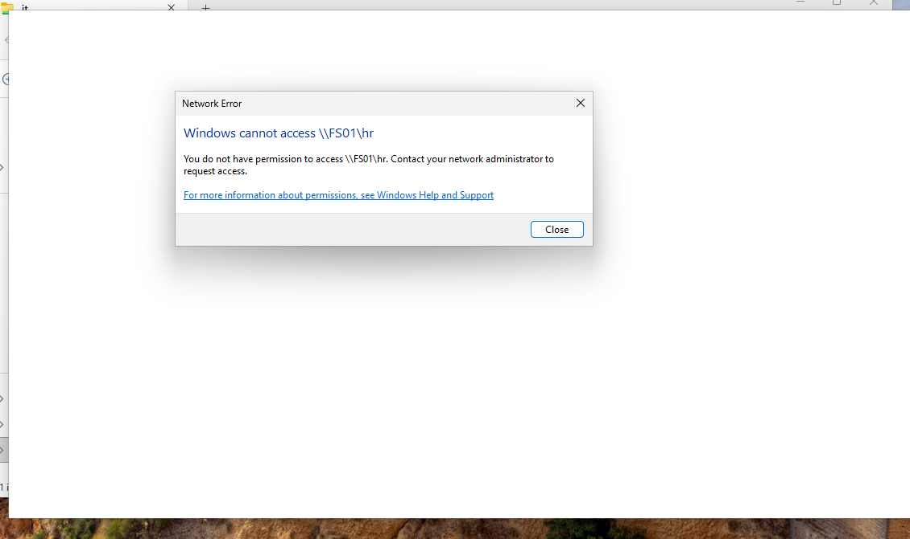

# 3K Technology | Active Directory & File Server Lab

**Windows Server 2025 | Active Directory | Group Policy | DNS | SMB | NTFS | VMware | PowerShell**

## Project Overview

Designed, deployed, and documented a virtual enterprise IT environment for a fictional organization, **3K Technology**, to gain hands-on experience with Windows Server administration, Active Directory, networking, and enterprise security.

The environment simulates a small business with four departments: **IT, Human Resources, Finance, and Sales**.

The project focuses on centralized identity management, domain authentication, Group Policy administration, departmental file sharing, and role-based access control.

### Project Objectives

* Deploy and configure Windows Server infrastructure.
* Implement centralized authentication using Active Directory Domain Services (AD DS).
* Configure DNS for domain name resolution.
* Organize users, computers, and security groups using Organizational Units (OUs).
* Implement workstation security settings using Group Policy.
* Deploy a dedicated file server with departmental SMB shares.
* Configure NTFS and SMB permissions using Active Directory security groups.
* Validate authorized and unauthorized access from a domain-joined workstation.
* Document infrastructure deployment, troubleshooting, and security testing.

---

## Network Architecture


### Infrastructure Overview

| System   | Operating System    | Role                                 | IP Address     |
| -------- | ------------------- | ------------------------------------ | -------------- |
| DC01     | Windows Server 2025 | Domain Controller, DNS, Group Policy | 192.168.148.10 |
| FS01     | Windows Server 2025 | File Server, SMB Shares              | 192.168.148.20 |
| CLIENT01 | Windows 11          | Domain-Joined Workstation            | DHCP           |

### Network Configuration

| Setting                 | Configuration            |
| ----------------------- | ------------------------ |
| Active Directory Domain | `corp.3ktechnology.test` |
| NetBIOS Domain          | `CORP`                   |
| Virtualization Platform | VMware Workstation       |
| Network Type            | VMware NAT (VMnet8)      |
| Network Subnet          | `192.168.148.0/24`       |
| Default Gateway         | `192.168.148.2`          |
| DNS Server              | `192.168.148.10`         |

The lab uses VMware NAT networking to provide connectivity between the virtual machines while maintaining a separate virtualized network environment.

---

## Key Project Accomplishments

### Active Directory Deployment

* Installed and configured Active Directory Domain Services on Windows Server 2025.
* Promoted DC01 to a domain controller.
* Configured DNS to support domain authentication and name resolution.
* Created a structured Organizational Unit hierarchy.
* Created eight employee accounts across four departments.
* Configured four departmental security groups.
* Joined CLIENT01 and FS01 to the Active Directory domain.
* Verified domain authentication from a Windows 11 workstation.

### Group Policy Administration

* Created a workstation security baseline GPO.
* Linked the security baseline to the Computers OU.
* Configured a 10-minute workstation inactivity lock.
* Configured domain account lockout settings.
* Reviewed password policy configuration.
* Used PowerShell to verify domain policy settings.

### File Server Deployment

* Deployed FS01 using Windows Server 2025.
* Installed the File Server role service.
* Provisioned an additional 10 GB virtual disk.
* Initialized the disk using GPT and formatted it with NTFS.
* Configured the `F:` drive for departmental data storage.
* Created four departmental SMB shares.
* Implemented departmental NTFS and SMB permissions.
* Integrated file access permissions with Active Directory security groups.

### Security Testing

* Authenticated to CLIENT01 using a domain account.
* Verified authorized access to the IT file share.
* Successfully created and saved a test file.
* Confirmed access restrictions for HR, Finance, and Sales shares.
* Documented access-control test results.

### Troubleshooting

* Encountered and resolved a File Server role installation issue.
* Captured installation error evidence.
* Verified File Server functionality after installation.
* Documented troubleshooting outcomes and post-resolution validation.

---

## Project Documentation

Detailed technical documentation and configuration screenshots are available below.

| Documentation                                                                | Description                                                                                                         |
| ---------------------------------------------------------------------------- | ------------------------------------------------------------------------------------------------------------------- |
| [Active Directory Configuration](documentation/02-Active-Directory-Setup.md) | Domain controller deployment, DNS, Organizational Units, user accounts, security groups, and domain authentication  |
| [Group Policy Configuration](documentation/03-Group-Policy.md)               | Workstation security baseline, password policy, account lockout settings, and PowerShell verification               |
| [File Server Configuration](documentation/04-File-Server-Configuration.md)   | Windows Server file services, storage configuration, SMB shares, NTFS permissions, and departmental access controls |
| [Security Testing](documentation/05-Security-Testing.md)                     | Authorized and unauthorized departmental file access testing                                                        |
| [Troubleshooting](documentation/06-Troubleshooting.md)                       | File Server installation failure, troubleshooting documentation, and post-resolution verification                   |

---

## Active Directory Structure

Created a structured Organizational Unit hierarchy to organize departmental users, computers, servers, and security groups.

```text
corp.3ktechnology.test
│
└── 3K-Technology
    │
    ├── Computers
    ├── Disabled-Accounts
    ├── Groups
    ├── Servers
    │
    └── Users
        ├── IT
        ├── HR
        ├── Finance
        └── Sales
```

### Departmental Security Groups

| Department      | Active Directory Security Group |
| --------------- | ------------------------------- |
| IT              | `SG_IT_Users`                   |
| Human Resources | `SG_HR_Users`                   |
| Finance         | `SG_Finance_Users`              |
| Sales           | `SG_Sales_Users`                |

These groups provide centralized access management for departmental resources.

**[View Active Directory Configuration and Screenshots](documentation/02-Active-Directory-Setup.md)**

---

## File Server Architecture

Configured FS01 to provide centralized departmental file storage.

### Storage Structure

```text
F:\
└── Shares\
    ├── IT\
    ├── HR\
    ├── Finance\
    └── Sales\
```

### Departmental SMB Shares

| Department | Network Share    | Authorized Security Group |
| ---------- | ---------------- | ------------------------- |
| IT         | `\\FS01\it`      | `SG_IT_Users`             |
| HR         | `\\FS01\hr`      | `SG_HR_Users`             |
| Finance    | `\\FS01\finance` | `SG_Finance_Users`        |
| Sales      | `\\FS01\sales`   | `SG_Sales_Users`          |

Implemented group-based access control using:

* Active Directory security groups
* SMB share permissions
* NTFS file system permissions

Departmental groups were configured with Modify permissions on their respective NTFS folders and Change permissions on their network shares.

**[View File Server Configuration and Screenshots](documentation/04-File-Server-Configuration.md)**

---

## Security Validation

Performed file access testing from CLIENT01 using the Active Directory account:

**Test Account:** `CORP\jcarter`
**Department:** IT
**Security Group:** `SG_IT_Users`

### Test Results

| Test                    | Expected Result  | Observed Result  | Status |
| ----------------------- | ---------------- | ---------------- | ------ |
| Domain authentication   | Successful login | Successful login | PASS   |
| Access IT share         | Allowed          | Allowed          | PASS   |
| Create file in IT share | Allowed          | File created     | PASS   |
| Access HR share         | Denied           | Access denied    | PASS   |
| Access Finance share    | Denied           | Access denied    | PASS   |
| Access Sales share      | Denied           | Access denied    | PASS   |

### Security Testing Outcome

**6 of 6 documented tests passed.**

The results demonstrate that the tested IT account could access its authorized departmental resources while access to other departmental shares was restricted.

Testing was limited to the IT account. Additional departmental account testing is planned.

### Access Denied Evidence



**[View Complete Security Testing Documentation](documentation/05-Security-Testing.md)**

---

## Technologies & Skills

| Technology                       | Skills Demonstrated                                        |
| -------------------------------- | ---------------------------------------------------------- |
| Windows Server 2025              | Server deployment, configuration, and administration       |
| Active Directory Domain Services | Domain deployment, authentication, and identity management |
| DNS                              | Domain name resolution and DNS validation                  |
| Group Policy                     | Workstation security and account policy administration     |
| SMB                              | Network file sharing and share permissions                 |
| NTFS                             | File system permissions and access control                 |
| VMware Workstation               | Virtual machine deployment and virtual networking          |
| Windows 11                       | Domain joining, authentication, and client testing         |
| PowerShell                       | Active Directory administration and policy verification    |
| Windows Server Manager           | Server role installation and file services management      |
| GitHub                           | Technical documentation and project portfolio management   |

---

## Troubleshooting Experience

During deployment, the File Server role installation encountered error:

`0xC004000D`

The issue was resolved, allowing the File Server role service to be installed successfully.

Post-resolution validation included:

* Confirming departmental SMB shares were operational.
* Verifying authorized IT share access.
* Successfully creating a file through the network share.
* Confirming unauthorized departmental access was restricted.

The installation error and subsequent verification are documented in the troubleshooting report.

**[View Troubleshooting Documentation](documentation/06-Troubleshooting.md)**

---

## Future Improvements

The following enhancements are planned to expand the lab into a more advanced enterprise environment.

### Security

* Expand departmental access testing to HR, Finance, and Sales accounts.
* Implement additional workstation security baselines.
* Review and strengthen domain password policies.
* Configure centralized Windows security event collection.

### Automation

* Develop PowerShell scripts for Active Directory user provisioning.
* Automate security group membership assignments.
* Automate common administrative tasks.

### Infrastructure

* Implement automated File Server backups.
* Test backup restoration and recovery procedures.
* Deploy additional Windows client workstations.
* Implement infrastructure monitoring.
* Expand the environment with additional network services.

---

## Project Status

**Completed — Initial Infrastructure Deployment and Validation**

The initial Active Directory and File Server environment has been deployed, configured, tested, and documented.

The lab demonstrates hands-on experience with Windows Server administration, identity management, Group Policy, network file sharing, and security validation.

Future enhancements will focus on automation, monitoring, backup and recovery, and expanded security testing.
