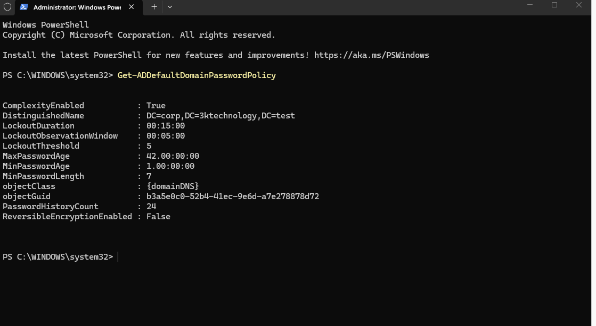
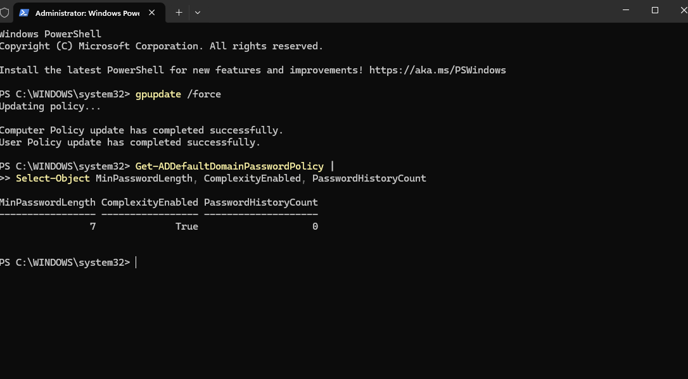
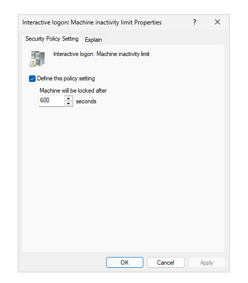
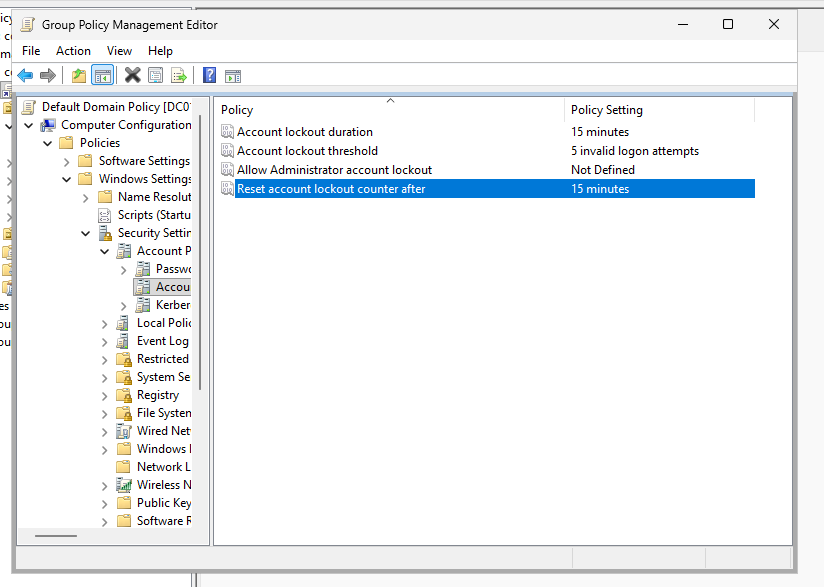
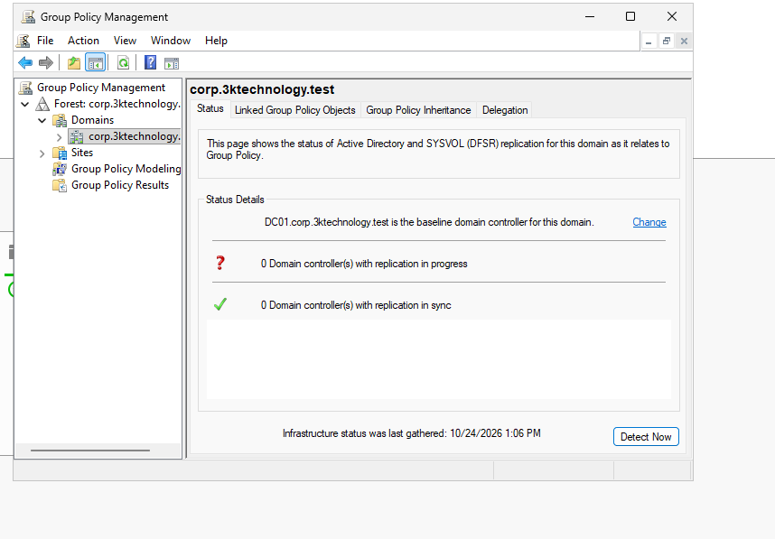

# Group Policy Configuration & Security Hardening

## Project Overview

As part of the **3K Technology Active Directory Lab**, I configured and managed Group Policy Objects (GPOs) to implement centralized security settings across a simulated enterprise Windows environment.

The objective was to strengthen workstation security, establish account lockout protections, and manage domain password policies using Windows Server 2025.

### Lab Environment

| Component               | Configuration                               |
| ----------------------- | ------------------------------------------- |
| Organization            | 3K Technology                               |
| Domain                  | `corp.3ktechnology.test`                    |
| Domain Controller       | DC01                                        |
| Server Operating System | Windows Server 2025                         |
| Client Operating System | Windows 11                                  |
| Network                 | VMware NAT — `192.168.148.0/24`             |
| Domain Controller IP    | `192.168.148.10`                            |
| Management Tools        | Group Policy Management Console, PowerShell |

---

## 1. Domain Password Policy

### Objective

Review the domain-wide password policy and verify its configuration using PowerShell.

### Configuration

The domain password policy was managed through the Default Domain Policy.

**Policy location:**

```text
Computer Configuration
└── Policies
    └── Windows Settings
        └── Security Settings
            └── Account Policies
                └── Password Policy
```

### Password Policy Settings

| Security Setting        | Configuration          |
| ----------------------- | ---------------------- |
| Minimum password length | 7 characters           |
| Password complexity     | Enabled                |
| Password history        | 0 passwords remembered |

These values reflect the lab configuration at the time of verification.

For a production environment, a stronger password policy would be recommended, including longer passwords and appropriate password reuse protections.

### Screenshot Evidence



---

## 2. Password Policy Verification Using PowerShell

### Objective

Validate the domain password policy through PowerShell rather than relying exclusively on the graphical management console.

### Verification Command

Executed the following command on DC01:

```powershell
Get-ADDefaultDomainPasswordPolicy
```

This command retrieves the default domain password policy, including:

* Minimum password length
* Password complexity requirements
* Password history
* Account lockout threshold
* Account lockout duration
* Account lockout observation window

### Screenshot Evidence



### Skills Demonstrated

* PowerShell administration
* Active Directory policy verification
* Security configuration auditing
* Windows Server management

---

## 3. Workstation Security Baseline

### Objective

Create a centralized workstation security policy to reduce unauthorized access to unattended computers.

### Group Policy Object

Created the following GPO:

**`3K - Workstation Security Baseline`**

The GPO was linked to the **Computers Organizational Unit** within Active Directory.

### Policy Configuration

Configured the following security setting:

| Setting                                     | Value       |
| ------------------------------------------- | ----------- |
| Interactive logon: Machine inactivity limit | 600 seconds |
| Equivalent time                             | 10 minutes  |

### Policy Location

```text
Computer Configuration
└── Policies
    └── Windows Settings
        └── Security Settings
            └── Local Policies
                └── Security Options
                    └── Interactive logon: Machine inactivity limit
```

### Security Purpose

The inactivity limit requires Windows to lock an inactive session after 10 minutes.

This helps protect workstations when employees leave their computers unattended.

### Screenshot Evidence



### Skills Demonstrated

* Creating Group Policy Objects
* Configuring workstation security
* Applying security baselines
* Linking GPOs to Organizational Units

---

## 4. Account Lockout Policy

### Objective

Implement account lockout controls to reduce the risk of repeated password-guessing attempts against domain accounts.

### Configuration

Configured the following settings through the Default Domain Policy:

| Security Setting                    | Configuration     |
| ----------------------------------- | ----------------- |
| Account lockout threshold           | 5 failed attempts |
| Account lockout duration            | 15 minutes        |
| Reset account lockout counter after | 15 minutes        |

### Policy Location

```text
Computer Configuration
└── Policies
    └── Windows Settings
        └── Security Settings
            └── Account Policies
                └── Account Lockout Policy
```

### How the Policy Works

If a user enters an incorrect password five times within the configured observation window, the account becomes temporarily locked.

The account lockout duration is configured for 15 minutes.

This provides an additional security control against repeated authentication attempts.

### Screenshot Evidence



### Skills Demonstrated

* Account security administration
* Authentication security controls
* Domain-wide policy management
* Security hardening

---

## 5. Group Policy Management

### Objective

Manage security configurations centrally using Group Policy Management Console (GPMC).

### Administrative Tasks

The following administrative tasks were performed:

1. Opened Group Policy Management Console on DC01.
2. Created the `3K - Workstation Security Baseline` GPO.
3. Linked the workstation security baseline to the Computers OU.
4. Configured the machine inactivity limit.
5. Managed domain account security settings through the Default Domain Policy.
6. Reviewed policy configurations using administrative tools and PowerShell.

### Screenshot Evidence



### Group Policy Architecture

```text
corp.3ktechnology.test
│
├── Default Domain Policy
│   ├── Password Policy
│   └── Account Lockout Policy
│
└── 3K-Technology
    │
    └── Computers OU
        │
        └── 3K - Workstation Security Baseline
            └── Machine Inactivity Limit: 600 seconds
```

This structure allows domain-wide account policies to be managed separately from workstation-specific security settings.

---

## 6. Security Improvements

The configured policies establish several foundational security controls.

| Security Control            | Purpose                                        |
| --------------------------- | ---------------------------------------------- |
| Workstation inactivity lock | Protects unattended sessions                   |
| Account lockout threshold   | Limits repeated failed authentication attempts |
| Account lockout duration    | Temporarily restricts locked accounts          |
| Password complexity         | Requires more complex passwords                |
| Centralized Group Policy    | Standardizes security settings                 |
| PowerShell verification     | Supports configuration auditing                |

These controls demonstrate how Active Directory and Group Policy can support consistent security administration.

---

## 7. Technical Skills Demonstrated

Through this portion of the lab, I gained hands-on experience with:

* Windows Server 2025 administration
* Active Directory Group Policy
* Group Policy Management Console
* Organizational Unit management
* Domain password policies
* Account lockout policies
* Windows workstation security
* PowerShell policy verification
* Security configuration documentation

---

## 8. Project Outcome

Successfully configured centralized security policies within the 3K Technology Active Directory environment.

The lab demonstrates the ability to create and manage Group Policy Objects, implement workstation security settings, configure domain account protections, and verify security policies using PowerShell.

These skills are directly applicable to enterprise IT support, Windows systems administration, and infrastructure security.

---

## Related Documentation

* [Active Directory Deployment](02-Active-Directory-Setup.md)
* [Main Project README](../README.md)
* [Network Architecture Diagram](../network-architecture.png)
