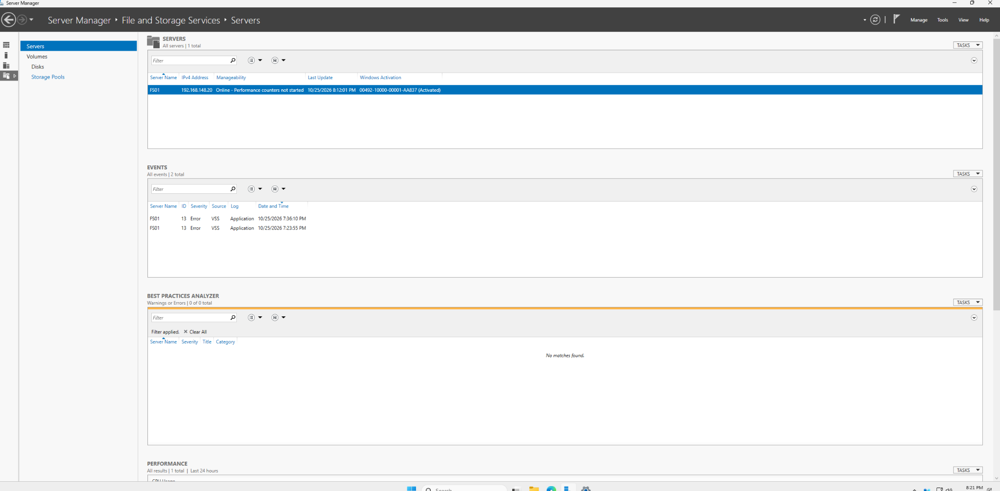
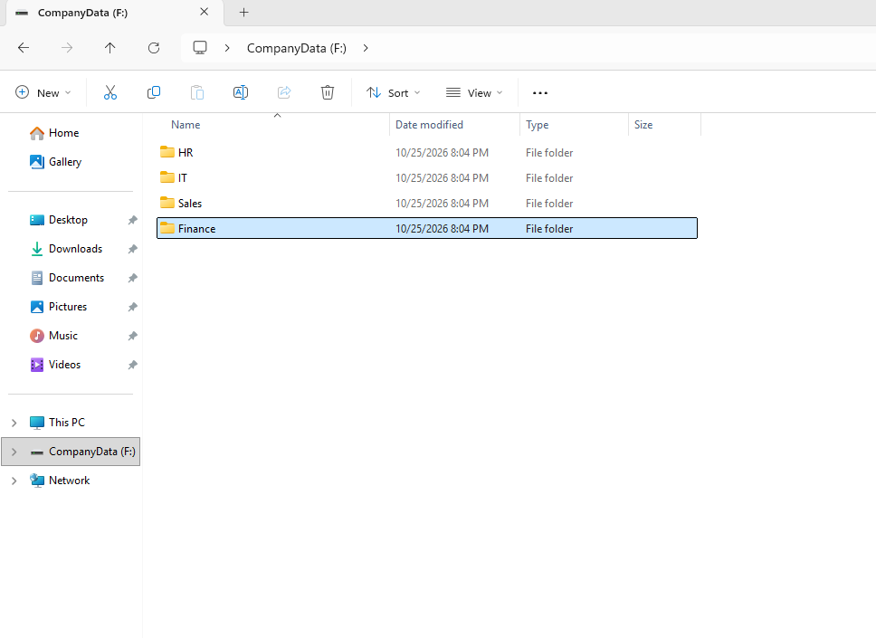
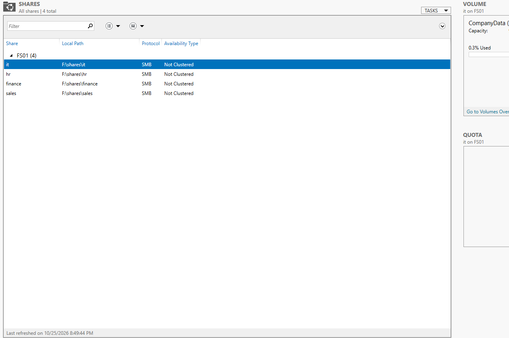
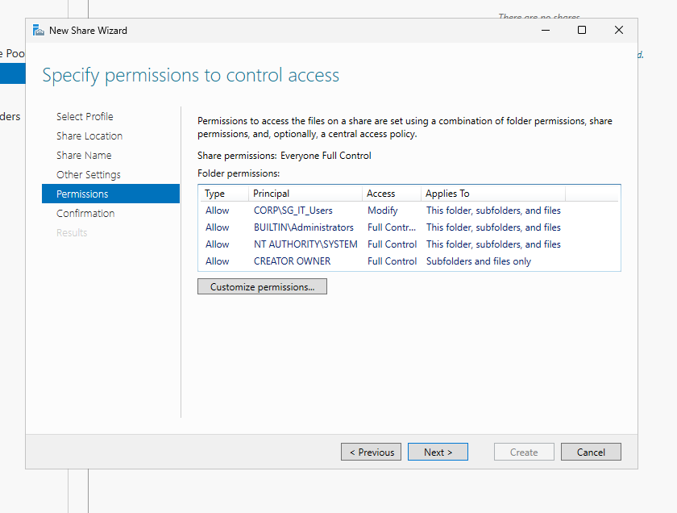
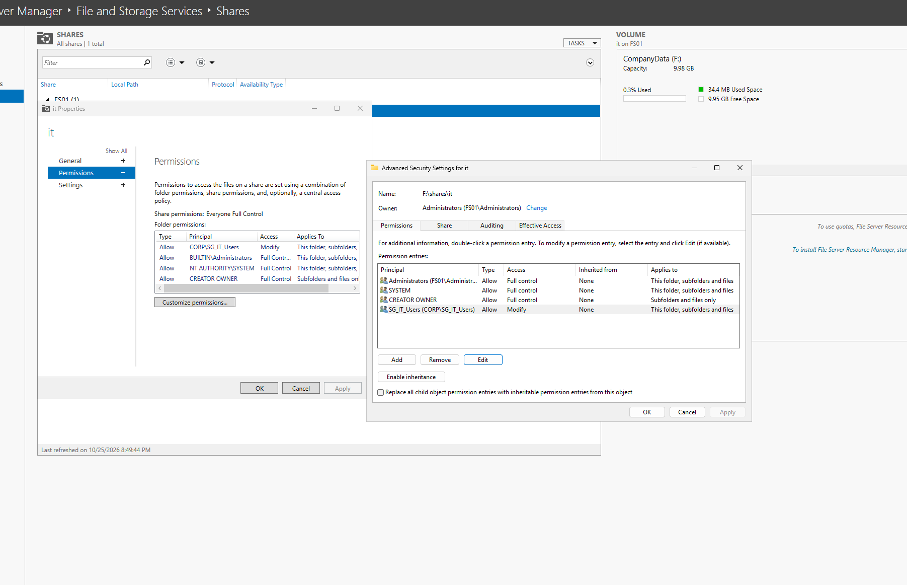
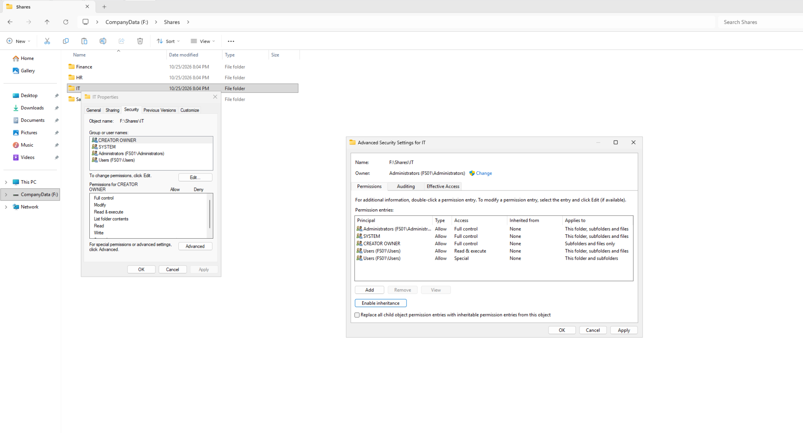
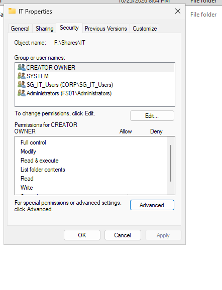
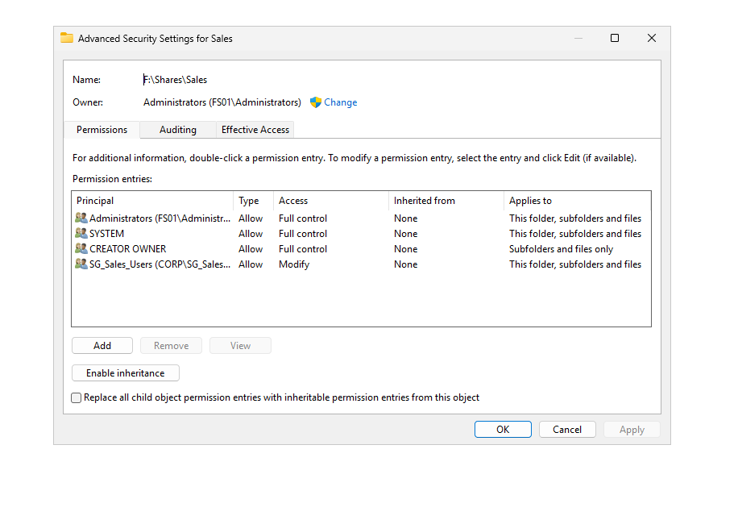

# Windows Server 2025 File Server Configuration

## Project Overview

Deployed and configured a Windows Server 2025 file server for the **3K Technology Active Directory Lab**.

The objective was to provide centralized departmental file storage while implementing role-based access control using Active Directory security groups, SMB shares, and NTFS permissions.

This project demonstrates hands-on experience with Windows Server administration, storage provisioning, file sharing, and access management.

---

## 1. Lab Environment

| Component                    | Configuration                   |
| ---------------------------- | ------------------------------- |
| Organization                 | 3K Technology                   |
| Active Directory Domain      | `corp.3ktechnology.test`        |
| Domain Controller            | DC01                            |
| File Server                  | FS01                            |
| File Server Operating System | Windows Server 2025             |
| File Server IP               | `192.168.148.20`                |
| Domain Controller IP         | `192.168.148.10`                |
| Client Workstation           | CLIENT01 — Windows 11           |
| Network                      | VMware NAT — `192.168.148.0/24` |

FS01 was joined to the Active Directory domain to support centralized authentication and departmental access management.

---

## 2. File Server Role Installation

Installed the File Server role service through Windows Server Manager.

The File Server role enables Windows Server to host shared folders accessible over the network using the Server Message Block (SMB) protocol.

### Administrative Tasks

1. Deployed Windows Server 2025 on FS01.
2. Joined FS01 to `corp.3ktechnology.test`.
3. Installed the File Server role service.
4. Configured an additional virtual disk for company data.
5. Created departmental folders.
6. Configured SMB shares.
7. Applied departmental permissions.

### Server Manager Evidence



---

## 3. Storage Configuration

Configured an additional virtual disk to separate departmental data from the operating system.

| Storage Component     | Configuration |
| --------------------- | ------------- |
| Operating System Disk | 60 GB         |
| Additional Data Disk  | 10 GB         |
| Partition Style       | GPT           |
| File System           | NTFS          |
| Drive Letter          | F:            |
| Volume Label          | CompanyData   |

### Departmental Folder Structure

```text
F:\
└── Shares\
    ├── IT\
    ├── HR\
    ├── Finance\
    └── Sales\
```

Separating company data from the operating system provides a more organized storage structure and simplifies future administration.

### Screenshot Evidence



---

## 4. SMB Share Configuration

Created four departmental SMB shares on FS01.

| Department      | Network Share    | Local Path          |
| --------------- | ---------------- | ------------------- |
| IT              | `\\FS01\it`      | `F:\Shares\IT`      |
| Human Resources | `\\FS01\hr`      | `F:\Shares\HR`      |
| Finance         | `\\FS01\finance` | `F:\Shares\Finance` |
| Sales           | `\\FS01\sales`   | `F:\Shares\Sales`   |

### SMB Shares



### Share Creation

Used Windows Server file-sharing management tools to configure departmental shares.

The share configuration process included selecting the folder path, defining the network share name, and assigning access permissions.



---

## 5. SMB Share Permissions

Configured departmental access using Active Directory security groups.

| SMB Share | Authorized Security Group | Permission |
| --------- | ------------------------- | ---------- |
| IT        | `CORP\SG_IT_Users`        | Change     |
| HR        | `CORP\SG_HR_Users`        | Change     |
| Finance   | `CORP\SG_Finance_Users`   | Change     |
| Sales     | `CORP\SG_Sales_Users`     | Change     |

Administrative accounts retain the necessary management permissions.

### Security Configuration

* Assigned departmental security groups to their respective shares.
* Removed unnecessary broad access.
* Configured Change permissions for authorized departmental users.
* Retained administrative access.

### Screenshot Evidence



---

## 6. NTFS Permissions

Configured NTFS permissions to restrict access to departmental folders.

Each department was assigned permissions through its corresponding Active Directory security group.

### Departmental NTFS Access

| Department | Security Group     | NTFS Permission |
| ---------- | ------------------ | --------------- |
| IT         | `SG_IT_Users`      | Modify          |
| HR         | `SG_HR_Users`      | Modify          |
| Finance    | `SG_Finance_Users` | Modify          |
| Sales      | `SG_Sales_Users`   | Modify          |

### Security Configuration

1. Opened the folder's Security properties.
2. Reviewed existing NTFS permissions.
3. Disabled inheritance on departmental folders.
4. Removed unnecessary broad user access.
5. Added the corresponding Active Directory security group.
6. Assigned Modify permissions.
7. Preserved required SYSTEM and administrative permissions.

### NTFS Permissions Evidence



### Folder Security Properties



### Advanced NTFS Security Settings



---

## 7. Understanding SMB and NTFS Permissions

Windows file servers use two permission layers when users access shared folders over the network.

**SMB share permissions** control access through the network share.

**NTFS permissions** control access to files and folders stored on the NTFS volume.

When both permission types apply, the user's effective access is limited by the more restrictive combination.

### Access Control Architecture

```text
Active Directory User
        |
        v
Department Security Group
        |
        v
SMB Share Permissions
        |
        v
NTFS Folder Permissions
        |
        v
Authorized Department Folder
```

Using Active Directory security groups simplifies permission administration and supports role-based access control.

---

## 8. Active Directory Integration

The file server uses departmental security groups created in Active Directory.

### Security Groups

```text
corp.3ktechnology.test
|
└── 3K-Technology
    └── Groups
        ├── SG_IT_Users
        ├── SG_HR_Users
        ├── SG_Finance_Users
        └── SG_Sales_Users
```

### Benefits

* Centralized user authentication
* Department-based access control
* Simplified permission management
* Reduced administrative overhead
* Consistent access permissions

When employees change departments, administrators can update their group membership rather than modifying permissions on individual folders.

---

## 9. File Server Access Testing

Performed access testing from CLIENT01, a Windows 11 workstation joined to the Active Directory domain.

### Test Account

| Setting        | Value          |
| -------------- | -------------- |
| Username       | `CORP\jcarter` |
| Department     | IT             |
| Security Group | `SG_IT_Users`  |
| Workstation    | CLIENT01       |

### Test Results

| Test                          | Expected Result | Observed Result |
| ----------------------------- | --------------- | --------------- |
| Access `\\FS01\it`            | Allowed         | PASS            |
| Create a file in the IT share | Allowed         | PASS            |
| Access `\\FS01\hr`            | Denied          | PASS            |
| Access `\\FS01\finance`       | Denied          | PASS            |
| Access `\\FS01\sales`         | Denied          | PASS            |

Successfully created and saved `IT-Access-Test.txt` in the IT share.

Attempts to access unauthorized departmental shares resulted in access-denied responses.

### Security Validation

The test confirmed that the IT account could access its authorized departmental share while access to the HR, Finance, and Sales shares was restricted.

Additional testing with accounts from other departments would provide broader validation.

---

## 10. File Server Troubleshooting

During deployment, the File Server role installation encountered the following error:

```text
0xC004000D
```

The installation issue was resolved, and the File Server role service was successfully installed.

This issue is included in the lab's troubleshooting documentation to demonstrate practical Windows Server problem-solving experience.

---

## 11. Technical Skills Demonstrated

* Windows Server 2025 administration
* Active Directory integration
* File Server role installation
* Virtual disk provisioning
* GPT partitioning
* NTFS volume configuration
* SMB share creation
* SMB permission management
* NTFS permission configuration
* Active Directory security groups
* Role-based access control
* File access testing
* Windows authentication
* Infrastructure documentation

---

## 12. Project Outcome

Successfully deployed a centralized Windows Server 2025 file server integrated with Active Directory.

Configured four departmental SMB shares and implemented group-based access controls using SMB and NTFS permissions.

Validated the configuration from a domain-joined Windows 11 workstation by confirming authorized access to the IT share and denied access to other departmental shares.

The completed file server demonstrates foundational skills in enterprise Windows administration, file services, and identity-based access
