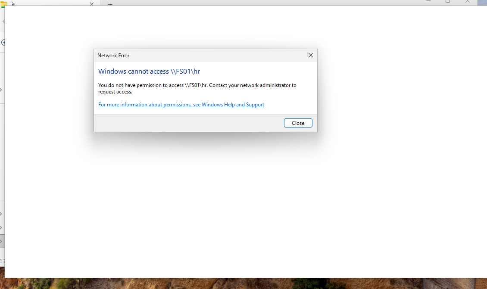

# Active Directory Security Testing & Access Control Validation

## Project Overview

Performed security testing within the **3K Technology Active Directory Lab** to verify departmental access controls configured on the Windows Server 2025 file server.

The objective was to confirm that authorized employees could access their assigned departmental resources while unauthorized access to other departments was restricted.

Testing focused on Active Directory security groups, SMB share permissions, and NTFS permissions.

---

## 1. Lab Environment

| Component                    | Configuration            |
| ---------------------------- | ------------------------ |
| Organization                 | 3K Technology            |
| Domain                       | `corp.3ktechnology.test` |
| Domain Controller            | DC01                     |
| File Server                  | FS01                     |
| Client Workstation           | CLIENT01                 |
| Client Operating System      | Windows 11               |
| File Server Operating System | Windows Server 2025      |
| File Server IP               | `192.168.148.20`         |
| Domain Controller IP         | `192.168.148.10`         |

---

## 2. Security Testing Objectives

The security testing process was designed to verify the following controls:

1. Domain users can authenticate using Active Directory credentials.
2. Departmental security groups control access to shared resources.
3. Authorized users can access their assigned departmental shares.
4. Unauthorized users cannot access restricted departmental shares.
5. NTFS and SMB permissions work together to enforce access restrictions.

---

## 3. Test Account Configuration

Testing was performed using an IT department account.

| Setting          | Configuration  |
| ---------------- | -------------- |
| Username         | `jcarter`      |
| Domain Account   | `CORP\jcarter` |
| Department       | IT             |
| Security Group   | `SG_IT_Users`  |
| Test Workstation | CLIENT01       |

The account was used to validate access to departmental resources hosted on FS01.

---

## 4. Departmental File Shares

Four SMB shares were configured on FS01.

| Department | Network Share    | Authorized Security Group |
| ---------- | ---------------- | ------------------------- |
| IT         | `\\FS01\it`      | `SG_IT_Users`             |
| HR         | `\\FS01\hr`      | `SG_HR_Users`             |
| Finance    | `\\FS01\finance` | `SG_Finance_Users`        |
| Sales      | `\\FS01\sales`   | `SG_Sales_Users`          |

Each share was configured with departmental SMB and NTFS permissions.

The goal was to enforce role-based access control using Active Directory group membership.

---

## 5. Authorized Access Testing

### Test 1 — IT Share Access

**Objective:** Verify that an IT department employee can access the IT file share.

**Test account:** `CORP\jcarter`

**Network path:**

```text
\\FS01\it
```

### Procedure

1. Signed in to CLIENT01 using the IT domain account.
2. Opened File Explorer.
3. Navigated to `\\FS01\it`.
4. Confirmed the shared folder was accessible.
5. Created a test file named `IT-Access-Test.txt`.
6. Saved the file successfully.

### Result

**PASS — Authorized Access Confirmed**

The IT account successfully accessed its assigned departmental share and created a test file.

This demonstrated that the account had the necessary permissions to access and modify resources within the IT share.

---

## 6. Unauthorized Access Testing

### Test 2 — HR Share Access

**Objective:** Verify that the IT account cannot access the HR department share.

**Network path:**

```text
\\FS01\hr
```

**Expected result:** Access denied.

**Observed result:** Access denied.

**Status:** PASS

### Test 3 — Finance Share Access

**Objective:** Verify that the IT account cannot access the Finance department share.

**Network path:**

```text
\\FS01\finance
```

**Expected result:** Access denied.

**Observed result:** Access denied.

**Status:** PASS

### Test 4 — Sales Share Access

**Objective:** Verify that the IT account cannot access the Sales department share.

**Network path:**

```text
\\FS01\sales
```

**Expected result:** Access denied.

**Observed result:** Access denied.

**Status:** PASS

### Screenshot Evidence

The following screenshot documents an access-denied result during departmental access testing.



---

## 7. Security Test Results

| Test ID | Test Description        | Expected Result  | Actual Result    | Status |
| ------- | ----------------------- | ---------------- | ---------------- | ------ |
| ST-01   | Domain authentication   | Successful login | Successful login | PASS   |
| ST-02   | Access IT share         | Allowed          | Allowed          | PASS   |
| ST-03   | Create file in IT share | Allowed          | File created     | PASS   |
| ST-04   | Access HR share         | Denied           | Access denied    | PASS   |
| ST-05   | Access Finance share    | Denied           | Access denied    | PASS   |
| ST-06   | Access Sales share      | Denied           | Access denied    | PASS   |

**Overall Result: 6 of 6 documented tests passed.**

The results validate access restrictions for the tested IT account. They do not establish that every departmental account has been tested.

---

## 8. Security Controls Validated

### Active Directory Authentication

Confirmed that CLIENT01 could authenticate a domain account through the Active Directory environment.

### Group-Based Access Control

Departmental security groups were used to assign permissions rather than granting access directly to individual employees.

### SMB Share Permissions

SMB permissions restricted access to departmental shares over the network.

### NTFS Permissions

NTFS permissions provided an additional layer of file and folder security.

### Least Privilege

The tested IT account could access its assigned departmental resources but was restricted from unrelated departmental shares.

---

## 9. Security Architecture

```text
Windows 11 — CLIENT01
         |
         | Domain Authentication
         v
Active Directory — DC01
         |
         | User: CORP\jcarter
         v
Security Group: SG_IT_Users
         |
         v
File Server — FS01
         |
         +---- \\FS01\it -------- ALLOWED
         |
         +---- \\FS01\hr -------- DENIED
         |
         +---- \\FS01\finance --- DENIED
         |
         +---- \\FS01\sales ----- DENIED
```

This configuration demonstrates how Active Directory security groups, SMB permissions, and NTFS permissions can be combined to restrict access to organizational resources.

---

## 10. Future Testing Improvements

Additional testing could strengthen the lab's security validation.

### Planned Tests

* Authenticate using an HR department account.
* Verify that HR employees can access `\\FS01\hr`.
* Confirm that HR employees cannot access IT, Finance, or Sales shares.
* Repeat the process for Finance and Sales accounts.
* Verify effective permissions for each department.
* Capture screenshots of successful and denied access attempts.
* Review Windows security event logs for relevant authentication events.

These tests would provide broader evidence of departmental access isolation.

---

## 11. Technical Skills Demonstrated

* Active Directory authentication
* Windows Server file services
* SMB share permissions
* NTFS permissions
* Active Directory security groups
* Role-based access control
* Least-privilege access design
* Windows 11 domain administration
* File access troubleshooting
* Security testing
* Technical documentation

---

## 12. Project Outcome

Successfully validated departmental access restrictions within the 3K Technology Active Directory Lab.

Testing confirmed that an authorized IT user could access and modify files within the IT share while access to HR, Finance, and Sales shares was denied.

The results demonstrate practical experience with identity-based access controls, Windows file server security, and enterprise infrastructure testing.

---

## Related Documentation

* [Active Directory Deployment](02-Active-Directory-Setup.md)
* [Group Policy Configuration](03-Group-Policy.md)
* [File Server Configuration](04-File-Server-Configuration.md)
* [Main Project README](../README.md)
