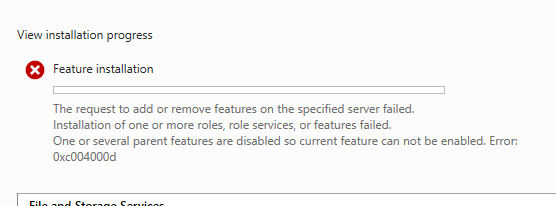

# Windows Server Troubleshooting & Issue Resolution

## Project Overview

During the deployment of the **3K Technology Active Directory Lab**, I encountered technical issues while configuring Windows Server infrastructure.

This document records the observed problems, troubleshooting context, outcomes, and verification evidence.

The goal is to demonstrate practical troubleshooting and technical documentation skills relevant to enterprise IT support and Windows systems administration.

---

## 1. Lab Environment

| Component               | Configuration                   |
| ----------------------- | ------------------------------- |
| Organization            | 3K Technology                   |
| Domain                  | `corp.3ktechnology.test`        |
| Domain Controller       | DC01                            |
| File Server             | FS01                            |
| Server Operating System | Windows Server 2025             |
| Client Workstation      | CLIENT01 — Windows 11           |
| Virtualization Platform | VMware Workstation              |
| Network                 | VMware NAT — `192.168.148.0/24` |

---

## 2. Incident 001 — File Server Role Installation Failure

### Problem

During the configuration of FS01, the installation of the Windows Server File Server role service failed.

The installation process returned the following error code:

```text
0xC004000D
```

This prevented the initial File Server role installation from completing successfully.

### Affected System

| Field              | Details                  |
| ------------------ | ------------------------ |
| Incident ID        | LAB-001                  |
| Hostname           | FS01                     |
| Operating System   | Windows Server 2025      |
| Affected Component | File Server role service |
| Status             | Resolved                 |

### Screenshot Evidence

The following screenshot captures the installation error encountered during deployment.



### Investigation

The installation failure was identified during the File Server role deployment process.

The error was recorded as part of the lab's troubleshooting evidence.

The specific root cause and individual corrective commands were not preserved in the available documentation, so they are not attributed to a particular Windows component or configuration.

### Resolution

The installation issue was resolved during the lab build, allowing the File Server role service to be installed successfully.

The precise remediation steps were not documented at the time.

### Verification

After the installation issue was resolved, FS01 was configured to host four departmental SMB shares:

| Share   | Network Path     |
| ------- | ---------------- |
| IT      | `\\FS01\it`      |
| HR      | `\\FS01\hr`      |
| Finance | `\\FS01\finance` |
| Sales   | `\\FS01\sales`   |

The shares were configured with departmental permissions and used during subsequent access-control testing.

### Outcome

**Resolved — File Server functionality restored.**

The successful deployment of departmental shares and subsequent client access testing demonstrated that the File Server environment was operational.

---

## 3. Post-Resolution Validation

After the File Server installation issue was resolved, the following functionality was confirmed:

| Validation Test                            | Result |
| ------------------------------------------ | ------ |
| File Server role installed                 | PASS   |
| Departmental SMB shares created            | PASS   |
| Active Directory security groups assigned  | PASS   |
| IT user accessed authorized share          | PASS   |
| IT user created a test file                | PASS   |
| IT user denied access to other departments | PASS   |

### Access Testing

Testing was performed from CLIENT01 using the domain account:

`CORP\jcarter`

The user successfully accessed:

```text
\\FS01\it
```

A test file named `IT-Access-Test.txt` was created successfully.

Attempts to access HR, Finance, and Sales shares were denied.

These tests provided functional evidence that the file server and departmental access controls were operating as intended for the tested account.

---

## 4. Troubleshooting Methodology

The following workflow provides a repeatable approach for future Windows Server incidents.

```text
Identify the Problem
        |
        v
Record Symptoms and Error Codes
        |
        v
Review System Configuration and Logs
        |
        v
Identify Potential Causes
        |
        v
Apply a Targeted Fix
        |
        v
Verify Service Functionality
        |
        v
Document the Resolution
```

For future incidents, I plan to record the exact diagnostic commands, event log entries, configuration changes, and verification results.

This will make troubleshooting documentation more reproducible and useful to other administrators.

---

## 5. Lessons Learned

### Record Error Codes

Capturing error messages provides a useful starting point for troubleshooting and future research.

### Verify Functionality After Resolution

A successful installation alone does not confirm that a service is fully operational.

Post-resolution testing should verify that the service performs its intended function.

### Document Corrective Actions

Recording the exact remediation steps helps make troubleshooting repeatable and supports knowledge sharing.

### Validate Access Controls

File Server functionality should be tested from a domain-joined workstation using an appropriate user account.

---

## 6. Technical Skills Demonstrated

* Windows Server troubleshooting
* File Server role deployment
* Error identification and documentation
* Post-resolution service validation
* SMB file sharing
* Active Directory integration
* NTFS and SMB permissions
* Windows client connectivity testing
* Technical incident documentation

---

## 7. Project Outcome

Successfully completed the FS01 File Server deployment after encountering an installation error.

Verified the operational state of the file server through departmental SMB share configuration and client access testing.

This incident reinforced the importance of recording error codes, validating functionality after corrective actions, and maintaining accurate troubleshooting documentation.

---

## Related Documentation

* [Active Directory Deployment](02-Active-Directory-Setup.md)
* [Group Policy Configuration](03-Group-Policy.md)
* [File Server Configuration](04-File-Server-Configuration.md)
* [Security Testing](05-Security-Testing.md)
* [Main Project README](../README.md)
